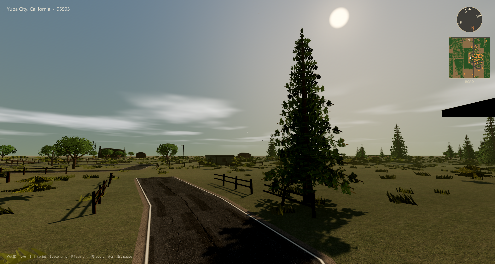
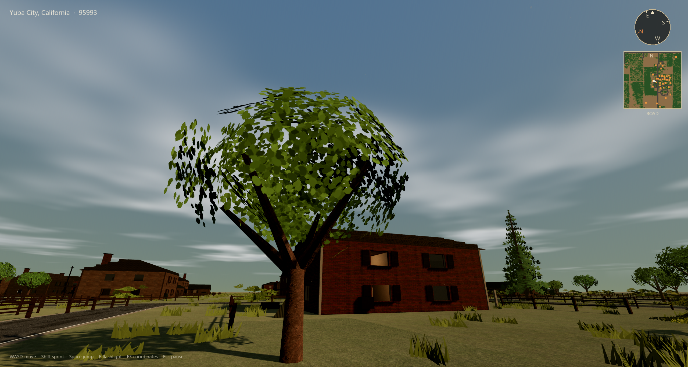
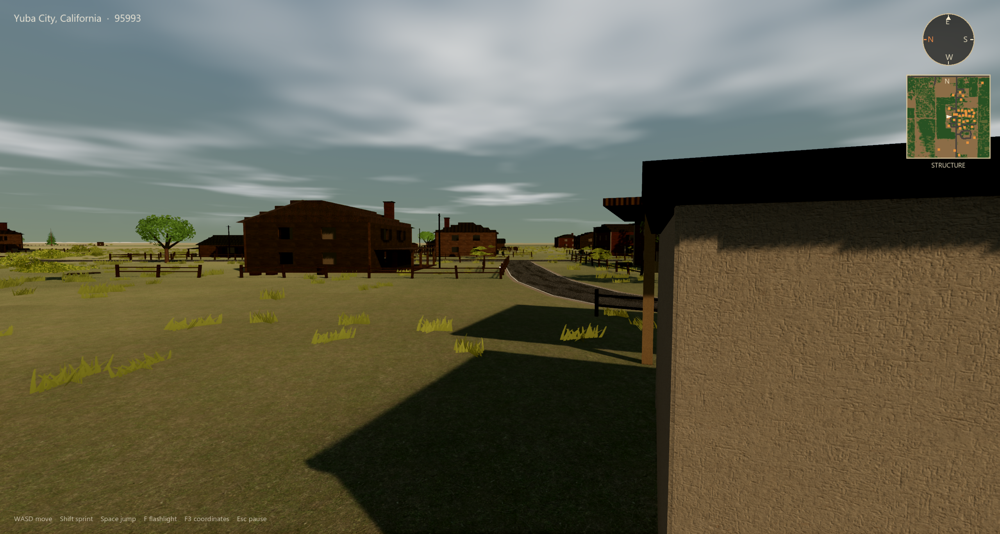
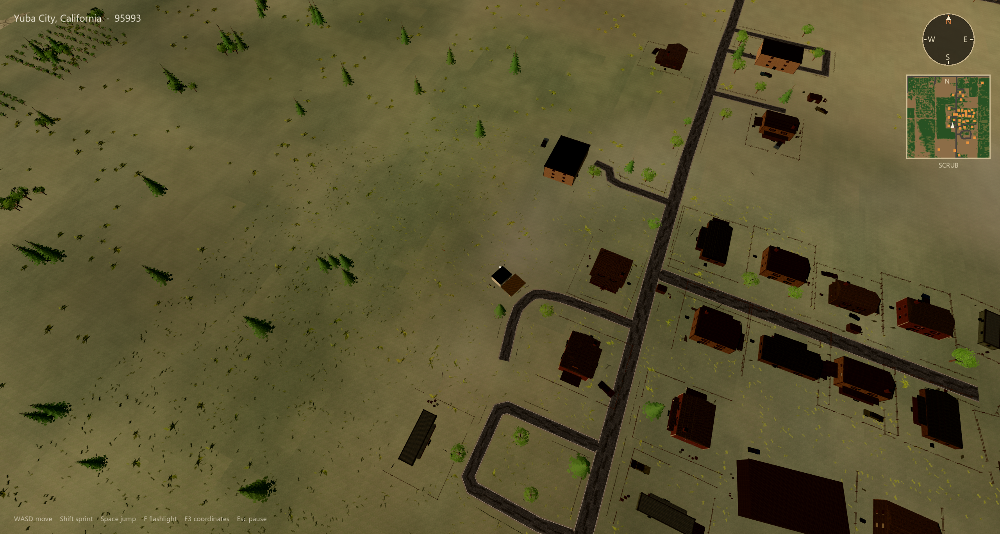

# ZIP Code World Generator

**Type a US ZIP. Get a walkable county.**

Ashen County turns a five-digit ZIP into a first-person Godot world — real elevation, OSM roads and buildings, USGS aerial tint, water where the map says water, and enough vegetation and structure kit to feel like a place you recognize… without pretending to be Google Earth.

> Not a 1:1 replica of reality. The point is **recognizable environments** you can explore, frame shots in, and eventually weaponize for survival horror.

---

## What you get

| Layer | Source | What lands in-game |
| --- | --- | --- |
| Place | Zippopotam.us | Lat/lon + city/state label |
| Terrain | AWS Terrarium | Heightfield mesh + far mountain skirt |
| Look of the ground | USGS imagery | Satellite tint on the terrain shader |
| Streets / water / footprints | OpenStreetMap | Roads, water polygons, building shells |
| Atmosphere | Forward+ Godot 4.7 | TAA, SSAO/SSIL-ready lighting, volumetric fog, long shadows |

Drop in a ZIP like `01002`, `95993`, or `86433`. First load downloads and caches tiles under Godot user data; next time it boots from disk.

---

## Screenshots

<p align="center">
  
  <br/><em>Street — generated buildings on real road centerlines</em>
</p>

<p align="center">
  
  
  <br/><em>Verge & horizon — terrain, vegetation, and sky volume</em>
</p>

<p align="center">
  
  <br/><em>Aerial — layout sanity check for roads and structure scatter</em>
</p>

---

## Quick start

1. Install **[Godot 4.7.2](https://godotengine.org/download)** (Forward+ / Vulkan).
2. Clone this repo.
3. Open the project folder in Godot (`project.godot`).
4. Hit **Play**.
5. Enter a **5-digit US ZIP** and generate.

### CLI / headless shot mode

Useful for automation and visual regression:

```bash
Godot_v4.7.2-stable_win64_console.exe --path . -- --zip 01002 --shot
```

Writes `shot_aerial.png`, `shot_street.png`, `shot_verge.png`, `shot_horizon.png`, `shot_interior.png` into the project root.

Headless smoke:

```bash
Godot_v4.7.2-stable_win64_console.exe --headless --path . -- --zip 01002
```

---

## Controls

| Input | Action |
| --- | --- |
| WASD | Move |
| Mouse | Look |
| Shift | Sprint |
| Space | Jump |
| F | Flashlight |
| F3 | Lat / lon / elevation overlay |
| Esc | Pause |

---

## How the pipeline works

```text
ZIP ──► geocode
        │
        ├─► Terrarium elevation tiles ──► heightfield + horizon skirt
        ├─► USGS NAIP / aerial         ──► terrain albedo tint
        └─► OSM Overpass               ──► roads, water, building footprints
                                              │
                                              ▼
                                    WorldBuilder meshes + materials
                                              │
                                              ▼
                              Vegetation stream + building kit + player spawn
```

**Cache:** `user://ashen/{zip}_v3/`  
On Windows that usually means  
`%APPDATA%\Godot\app_userdata\Ashen County\ashen\`.

Re-gen a ZIP by deleting its cache folder.

---

## Project layout

```text
Ashen County/
├── scenes/main.tscn          # Boot + menu + world host
├── scripts/
│   ├── main.gd               # ZIP UI, shot mode, pause
│   ├── geo_service.gd        # Network + cache for geo data
│   ├── world_builder.gd      # Terrain, roads, water, lights
│   ├── building_kit.gd       # Farmhouse / ranch / shed kits
│   ├── vegetation.gd         # Trees, shrubs, ground cover stream
│   ├── materials_lib.gd      # Shared PBR + tint helpers
│   └── player.gd             # CharacterBody3D + camera
├── shaders/                  # Terrain, foliage, sky, water, roads…
└── assets/                   # Nature GLBs, PBR ground, building textures
```

---

## Design notes (read before filing “why isn’t my house exact?”)

- **Recognizable, not cadastral.** Footprints follow OSM where density allows; façades are kitbashed, not photogrammetry.
- **Playable radius.** Local map is ~1 km across with a much larger elevation skirt so distant ridges stay visible.
- **Free / CC assets** are used for nature and PBR surfaces. Credit lives with the source packs in `assets/`.
- **Graphics are still evolving.** The generator is the feature. Photoreal AAA polish is the moving target, not a finished claim.

---

## Requirements

- Godot **4.7.x** (tested on **4.7.2**)
- GPU with Vulkan (Forward+)
- Network on first load of each ZIP (HTTPS to Zippopotam, AWS elevation, USGS, OSM)

---

## Status

World generation only — movement, look, flashlight, pause. No survival loop yet (hunger, inventory, enemies). That comes later on top of this map.

---

## License / data

- **Code & project files:** yours under this repository (add a formal license file when you’re ready).
- **Third-party meshes & textures:** retain their original author licenses (Poly Haven / ambientCG–style packs and similar).
- **Map data:** OSM © OpenStreetMap contributors; elevation / imagery per their respective public terms. Use respectfully; cache locally; don’t hammer public endpoints.

---

## Contributing / hacking

Want a new façade kit, better tree LODs, or a different Overpass filter? Start in:

- `scripts/building_kit.gd` — shells, windows, porches  
- `scripts/vegetation.gd` — density, impostors, hero meshes  
- `scripts/geo_service.gd` — tile zooms, cache version, User-Agent  

Open an issue with a ZIP that looks wrong and a screenshot. Specific beats vibes.

---

<p align="center">
  <strong>Pick a ZIP. Walk the county.</strong><br/>
  <sub>Built in Godot 4.7 · Forward+ · real US map data</sub>
</p>
